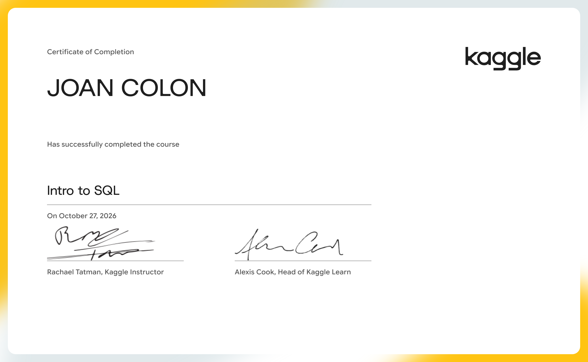
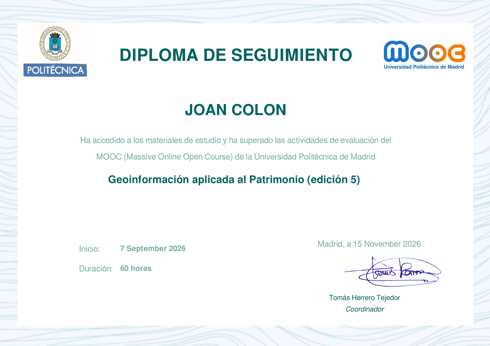

---
hide:
  - navigation
---

# Certifications

## Completed

-   

    **Editing Basics (ArcGIS Pro)**

    Esri · November 2025

-   

    **Introduction to CAD and BIM Data**

    Esri · January 2026

-   

    **Introduction to SQL**

    Kaggle · October 2026

-   

    **Diploma de Seguimiento — Geoinformación aplicada al Patrimonio**

    Universidad Politécnica de Madrid · November 2026

## In Progress

<!-- TODO: 2 in-progress certifications — names and issuers not yet provided -->
