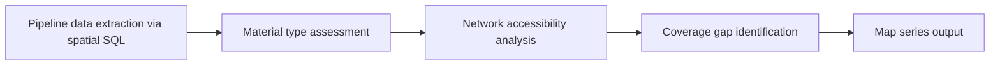

---
hide:
  - navigation
---

## At a Glance

Spatial SQL-driven analytics for utility infrastructure annexation planning and coverage gap analysis. Role: GIS analyst. `PostGIS` `Spatial SQL` `ArcGIS` `Network Analysis`

## Problem

Municipal planners needed to assess water and wastewater network coverage before approving service area expansions. No existing spatial analysis existed for feasibility or gap identification.

## Data

- Water and wastewater pipeline data
- Material types
- Spatial network data
- CRS: [PLACEHOLDER]
- Record count: [PLACEHOLDER]

## Pipeline

1. Extracted pipeline data via spatial SQL
2. Assessed material types
3. Ran network accessibility analysis
4. Identified coverage gaps and feasibility of utility extensions
5. Delivered map series output

## Result

- [PLACEHOLDER] Delivered GIS-driven map series supporting interdepartmental coordination and annexation decisions (Utilities Annexation Study Area project)
- [PLACEHOLDER] Also developed a USGS Earthquake Hazards Program (EHP) earthquake visualization for Puerto Rico, enhancing monitoring, research, and preparedness

## What I'd Do Next

Automate the gap analysis as a scheduled web map, eliminating the static map series update cycle.

## Links

- [Live viewer]()
- [Repo]()
- [README]()
