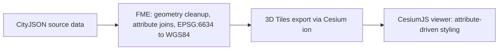

---
hide:
  - navigation
---

## At a Glance

3D CityJSON building dataset transformed into a web-browsable digital twin; [PLACEHOLDER — fill in before publishing] `CityJSON` `FME` `OGC 3D Tiles` `CesiumJS`.

## Problem

[PLACEHOLDER — fill in before publishing]

## Data

- Building geometry: CityJSON LOD1 (source: [PLACEHOLDER — fill in before publishing])
- Attributes: parcel ID, master parcel ID, height (m), ground elevation (m), year built, total units, centroid X/Y, height source
- Projection: EPSG:6634, reprojected to WGS84 for the web viewer

## Pipeline

1. CityJSON source data ingested and validated
2. FME workbench: geometry cleanup, attribute joins, coordinate transform (EPSG:6634 → WGS84)
3. Export to 3D Tiles (Cesium ion pipeline)
4. Served through CesiumJS with attribute-driven styling

## Result

- [PLACEHOLDER] Color-by-height and color-by-year-built styling, click any building for its full attribute table.

<iframe
  src="../../assets/cadastral-viewer.html"
  style="width:100%; height:600px; border:1px solid var(--md-default-fg-color--lightest); border-radius:8px;"
  loading="lazy">
</iframe>

!!! note "Running this yourself"
    The viewer above needs a Cesium ion access token scoped to this asset — append
    `?token=YOUR_TOKEN` to the iframe's `src`, or set `window.CESIUM_ION_TOKEN` before
    the page's script runs. Scope the token to this one asset ID in the
    [Cesium ion dashboard](https://ion.cesium.com/tokens) before publishing; a
    client-side token restricted this way is the supported pattern for public
    CesiumJS demos — it is not a server secret.

<iframe
  src="../../demos/cesium-session1/index.html?assetId=5834028"
  style="width:100%; height:600px; border:1px solid var(--md-default-fg-color--lightest); border-radius:8px;"
  loading="lazy">
</iframe>

!!! note "Running this yourself"
    The CesiumJS Bootcamp Viewer above needs a Cesium ion access token scoped to
    asset `5834028` — append `?token=YOUR_TOKEN` to the iframe's `src` above, or
    set `window.CESIUM_ION_TOKEN` before the page's script runs. Same supported
    pattern as the viewer above: a client-side token restricted to this one
    asset ID in the [Cesium ion dashboard](https://ion.cesium.com/tokens) is not
    a server secret.

## What I'd Do Next

[PLACEHOLDER — fill in before publishing]

## Links

- [Live viewer]()
- [Repo]()
- [README]()
