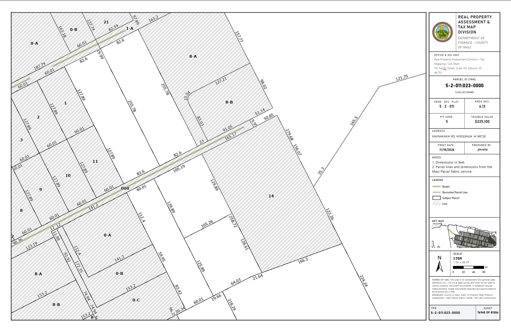

---
hide:
  - navigation
---

# Cadastral Mapping Automation Guide (POC)

Automating bulk parcel mapbook production in ArcGIS Pro with ArcPy, from a Parquet parcel fabric to a multi-page PDF map series.

<ul class="chips">
<li>ArcPy</li>
<li>ArcGIS Pro</li>
<li>Map Series</li>
<li>Parcel Fabric</li>
<li>Cadastral Mapping</li>
</ul>

<nav class="section-nav">
<a href="#overview">Overview</a>
<a href="#workflow">Workflow</a>
<a href="#tools-technologies">Tools &amp; Technologies</a>
<a href="#status-next-steps">Status &amp; Next Steps</a>
</nav>

## Overview

Producing parcel map sheets by hand in ArcGIS Pro is slow and hard to repeat: each sheet has to be set up, checked and exported one by one, and scripts often break because of hardcoded file paths. This proof of concept automates the whole run. A single script reads the parcel fabric, drives a staged layout template, and exports every sheet into one PDF mapbook.

<h2 id="workflow">Workflow</h2>

  

    
Follow the process. Expand a step for the details.

    <button type="button" class="wf-play" aria-pressed="true">Pause animation</button>
  

  <ol class="wf-steps">
    <li class="wf-step">
      <article class="wf-card">
        

          <svg viewBox="0 0 24 24" width="18" height="18" fill="none" stroke="currentColor" stroke-width="1.75" stroke-linecap="round" stroke-linejoin="round"><ellipse cx="12" cy="5" rx="8" ry="3"/><path d="M4 5v14c0 1.7 3.6 3 8 3s8-1.3 8-3V5"/><path d="M4 12c0 1.7 3.6 3 8 3s8-1.3 8-3"/></svg>
          01
        

        <h3 class="wf-card__title">Parcel Data Preparation</h3>
        

          

            
Converted the Parcels_2025 layer into <code>parcel_fabric.parquet</code> with pandas and PyArrow, stored under a relative path (<code>../data/processed/</code>) so the script runs on any machine.

          

        

        <button type="button" class="wf-toggle" aria-expanded="false" aria-controls="wf-p1">Details +</button>
      </article>
    </li>
    <li class="wf-step">
      <article class="wf-card">
        

          <svg viewBox="0 0 24 24" width="18" height="18" fill="none" stroke="currentColor" stroke-width="1.75" stroke-linecap="round" stroke-linejoin="round"><rect x="3" y="3" width="18" height="18" rx="2"/><path d="M3 9h18"/><path d="M9 9v12"/></svg>
          02
        

        <h3 class="wf-card__title">Layout Template Staging</h3>
        

          

            
Built <code>parcel_stage_template.aprx</code> as the reusable layout: map frame, north arrow, scale bar, legend and the parcel information panel.

          

        

        <button type="button" class="wf-toggle" aria-expanded="false" aria-controls="wf-p2">Details +</button>
      </article>
    </li>
    <li class="wf-step">
      <article class="wf-card">
        

          <svg viewBox="0 0 24 24" width="18" height="18" fill="none" stroke="currentColor" stroke-width="1.75" stroke-linecap="round" stroke-linejoin="round"><path d="M8 6l-6 6 6 6"/><path d="M16 6l6 6-6 6"/></svg>
          03
        

        <h3 class="wf-card__title">Bulk Map Series Automation</h3>
        

          

            
<code>01_build_parcel_mapbook.py</code> uses native ArcPy bindings to open the template, replace hardcoded paths with relative ones, and generate one map sheet per parcel.

          

        

        <button type="button" class="wf-toggle" aria-expanded="false" aria-controls="wf-p3">Details +</button>
      </article>
    </li>
    <li class="wf-step">
      <article class="wf-card">
        

          <svg viewBox="0 0 24 24" width="18" height="18" fill="none" stroke="currentColor" stroke-width="1.75" stroke-linecap="round" stroke-linejoin="round"><path d="M14 3H6a2 2 0 0 0-2 2v14a2 2 0 0 0 2 2h12a2 2 0 0 0 2-2V9z"/><path d="M14 3v6h6"/><path d="M9 15l2 2 4-4"/></svg>
          04
        

        <h3 class="wf-card__title">QC &amp; PDF Mapbook Export</h3>
        

          

            
Checked the cartographic vector layers on each sheet, then exported the full series as a single multi-page PDF mapbook.

          

        

        <button type="button" class="wf-toggle" aria-expanded="false" aria-controls="wf-p4">Details +</button>
      </article>
    </li>
  </ol>

## Tools & Technologies

- **ArcGIS Pro & ArcPy** — layout template and map series automation
- **Python, pandas & PyArrow** — reading and preparing the Parquet parcel fabric
- **Conda** — isolated environment (`prod-map-cadas-env`)
- **Parquet** — compact, fast storage for the parcel fabric

## Status & Next Steps

**Status:** In progress (last updated 2026-10-12).

- Finish the cartographic QC of all layer components.
- Move the layout to a **web print template** so map sheets can be produced from the browser.

