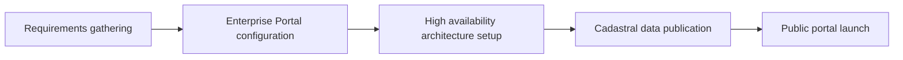

---
hide:
  - navigation
---

## At a Glance

High-availability ArcGIS Enterprise Portal deployment for Puerto Rico's municipal cadastral data platform. Role: implementation and configuration. `ArcGIS Enterprise Portal` `High Availability Architecture`

## Problem

CRIM needed a public-facing portal to serve authoritative cadastral data for all Puerto Rico municipalities — aerial photos, cadastral maps, boundary lists — with purchase and download capability.

## Data

- Cadastral data for Puerto Rico, island-wide
- Aerial photography
- Boundary datasets
- Record count: [PLACEHOLDER]

## Pipeline

1. Requirements gathering
2. Enterprise Portal configuration
3. High availability architecture setup
4. Cadastral data publication
5. Public portal launch

## Result

- [PLACEHOLDER] Live portal serving island-wide cadastral data with browse, purchase, and download capability

## What I'd Do Next

Add an OGC API — Features endpoint to expose cadastral data as open standards-compliant JSON without requiring portal authentication.

## Links

- [Live portal](https://catastro.crimpr.net/cdprpc/)
- [Repo]()
- [README]()
