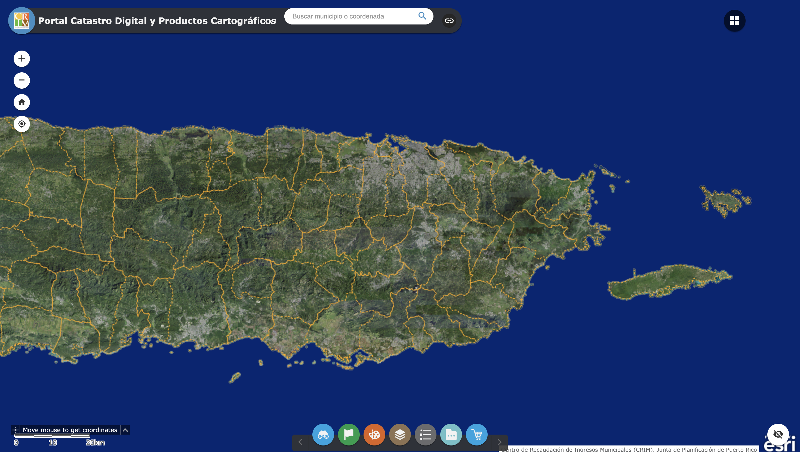

---
hide:
  - navigation
---

# CRIM Cadastral Portal — High Availability ArcGIS Enterprise

A high-availability ArcGIS Enterprise portal that gives the public up-to-date cadastral data for all of Puerto Rico.

<ul class="chips">
<li>ArcGIS Enterprise</li>
<li>Portal for ArcGIS</li>
<li>High Availability</li>
<li>Cadastral Data</li>
<li>Puerto Rico</li>
</ul>

<nav class="section-nav">
<a href="#overview">Overview</a>
<a href="#workflow">Workflow</a>
<a href="#portal-features">Portal Features</a>
<a href="#tools-technologies">Tools &amp; Technologies</a>
</nav>

## Overview

I assisted GMT, Corp. with deploying and configuring an ArcGIS Enterprise portal in a high-availability architecture for CRIM (Centro de Recaudación de Ingresos Municipales, the Municipal Revenue Collection Center). The web portal shows the most up-to-date cadastral data for the island, and lets users browse, purchase and download cartographic products such as aerial photos, cadastral maps and boundary lists.

<h2 id="workflow">Workflow</h2>

  

    
Follow the process. Expand a step for the details.

    <button type="button" class="wf-play" aria-pressed="true">Pause animation</button>
  

  <ol class="wf-steps">
    <li class="wf-step">
      <article class="wf-card">
        

          <svg viewBox="0 0 24 24" width="18" height="18" fill="none" stroke="currentColor" stroke-width="1.75" stroke-linecap="round" stroke-linejoin="round"><rect x="3" y="3" width="7" height="7" rx="1"/><rect x="14" y="3" width="7" height="7" rx="1"/><rect x="8.5" y="14" width="7" height="7" rx="1"/><path d="M6.5 10v2h11v-2M12 12v2"/></svg>
          01
        

        <h3 class="wf-card__title">High Availability Architecture</h3>
        

          

            
Planned the ArcGIS Enterprise deployment with redundant components, so the portal stays online if one machine fails.

          

        

        <button type="button" class="wf-toggle" aria-expanded="false" aria-controls="wf-p1">Details +</button>
      </article>
    </li>
    <li class="wf-step">
      <article class="wf-card">
        

          <svg viewBox="0 0 24 24" width="18" height="18" fill="none" stroke="currentColor" stroke-width="1.75" stroke-linecap="round" stroke-linejoin="round"><rect x="3" y="4" width="18" height="6" rx="1.5"/><rect x="3" y="14" width="18" height="6" rx="1.5"/><path d="M7 7h.01M7 17h.01"/></svg>
          02
        

        <h3 class="wf-card__title">Portal Deployment &amp; Configuration</h3>
        

          

            
Deployed and configured the ArcGIS Enterprise portal with GMT, Corp. for CRIM.

          

        

        <button type="button" class="wf-toggle" aria-expanded="false" aria-controls="wf-p2">Details +</button>
      </article>
    </li>
    <li class="wf-step">
      <article class="wf-card">
        

          <svg viewBox="0 0 24 24" width="18" height="18" fill="none" stroke="currentColor" stroke-width="1.75" stroke-linecap="round" stroke-linejoin="round"><path d="M3 6l6-3 6 3 6-3v15l-6 3-6-3-6 3z"/><path d="M9 3v15M15 6v15"/></svg>
          03
        

        <h3 class="wf-card__title">Cadastral Content</h3>
        

          

            
Made the island's most up-to-date cadastral data available in the portal, along with aerial photos, cadastral maps and boundary lists.

          

        

        <button type="button" class="wf-toggle" aria-expanded="false" aria-controls="wf-p3">Details +</button>
      </article>
    </li>
    <li class="wf-step">
      <article class="wf-card">
        

          <svg viewBox="0 0 24 24" width="18" height="18" fill="none" stroke="currentColor" stroke-width="1.75" stroke-linecap="round" stroke-linejoin="round"><circle cx="12" cy="12" r="9"/><path d="M3 12h18"/><path d="M12 3a14 14 0 0 1 0 18M12 3a14 14 0 0 0 0 18"/></svg>
          04
        

        <h3 class="wf-card__title">Public Web Portal</h3>
        

          

            
Opened the portal to users, who can browse, purchase and download cartographic products online.

          

        

        <button type="button" class="wf-toggle" aria-expanded="false" aria-controls="wf-p4">Details +</button>
      </article>
    </li>
  </ol>

## Portal Features

- Most up-to-date cadastral data for the whole island
- Browse cartographic products online
- Purchase and download aerial photos, cadastral maps and boundary lists
- High-availability setup for continuous public access

## Tools & Technologies

- **ArcGIS Enterprise** — Portal for ArcGIS in a high-availability deployment
- **Cadastral GIS data** — parcels, aerial imagery and boundaries for Puerto Rico

