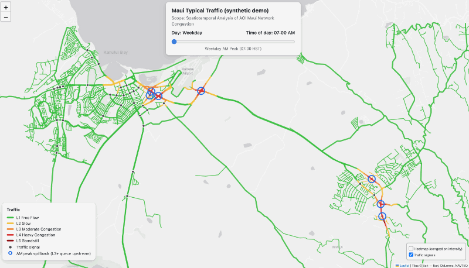

---
hide:
  - navigation
---

# Maui Commute Traffic Hotspot Analyzer

A zero-cost spatial pipeline that fuses TomTom traffic flow data with OpenStreetMap road networks to flag the worst AM spillback intersections on Maui's Kula → Kahului commute.

<ul class="chips">
<li>Python</li>
<li>OSMnx</li>
<li>TomTom Flow API</li>
<li>Folium</li>
<li>GeoPandas</li>
<li>SQLite</li>
<li>APScheduler</li>
</ul>

<nav class="section-nav">
<a href="#problem-statement">Problem Statement</a>
<a href="#data-technical-architecture">Data &amp; Technical Architecture</a>
<a href="#results-impact">Results &amp; Impact</a>
</nav>

## Problem Statement

Maui's Kula → Kahului commute funnels through a handful of signalized intersections, but there was no quick, zero-cost way to see which ones actually cause the worst morning spillback. Commercial traffic APIs are expensive to query continuously, and raw OpenStreetMap road data carries no congestion signal on its own.

<h2 id="data-technical-architecture">Data &amp; Technical Architecture</h2>

  

    
Follow the process. Expand a step for the details.

    <button type="button" class="wf-play" aria-pressed="true">Pause animation</button>
  

  <ol class="wf-steps">
    <li class="wf-step">
      <article class="wf-card">
        

          <svg viewBox="0 0 24 24" width="18" height="18" fill="none" stroke="currentColor" stroke-width="1.75" stroke-linecap="round" stroke-linejoin="round"><path d="M3 6l6-3 6 3 6-3v15l-6 3-6-3-6 3z"/><path d="M9 3v15M15 6v15"/></svg>
          01
        

        <h3 class="wf-card__title">Road Network Ingestion</h3>
        

          

            
Downloaded the OSM drive network for the demo area via OSMnx (~4,250 roads, 945 km) and cached it locally; each road is split into pieces of 250 m or less while keeping true road geometry, giving roughly 6,400 addressable segments.

          

        

        <button type="button" class="wf-toggle" aria-expanded="false" aria-controls="wf-p1">Details +</button>
      </article>
    </li>
    <li class="wf-step">
      <article class="wf-card">
        

          <svg viewBox="0 0 24 24" width="18" height="18" fill="none" stroke="currentColor" stroke-width="1.75" stroke-linecap="round" stroke-linejoin="round"><circle cx="12" cy="12" r="9"/><path d="M12 7v5l3 3"/></svg>
          02
        

        <h3 class="wf-card__title">Scheduled Traffic Collection</h3>
        

          

            
An APScheduler cron daemon sweeps the TomTom Flow Segment Data API across four daily windows (AM Peak, Midday, PM Peak, Weekend), rate-limited and cached in SQLite, staying well within the free tier's 2,500 requests/day. A deterministic synthetic mode generates the same data offline for testing, with no API key required.

          

        

        <button type="button" class="wf-toggle" aria-expanded="false" aria-controls="wf-p2">Details +</button>
      </article>
    </li>
    <li class="wf-step">
      <article class="wf-card">
        

          <svg viewBox="0 0 24 24" width="18" height="18" fill="none" stroke="currentColor" stroke-width="1.75" stroke-linecap="round" stroke-linejoin="round"><circle cx="5" cy="6" r="2"/><circle cx="5" cy="18" r="2"/><circle cx="12" cy="12" r="2"/><circle cx="19" cy="6" r="2"/><circle cx="19" cy="18" r="2"/><path d="M7 7l3 3.5M7 17l3-3.5M14 10.5L17 7M14 13.5L17 17"/></svg>
          03
        

        <h3 class="wf-card__title">Spillback Detection</h3>
        

          

            
Scanned every OSM-tagged signalized intersection in the network and, for each approach, walked backward against traffic counting contiguous congested road pieces; an intersection is flagged when its longest approach queue reaches the minimum threshold during the Weekday AM Peak.

          

        

        <button type="button" class="wf-toggle" aria-expanded="false" aria-controls="wf-p3">Details +</button>
      </article>
    </li>
    <li class="wf-step">
      <article class="wf-card">
        

          <svg viewBox="0 0 24 24" width="18" height="18" fill="none" stroke="currentColor" stroke-width="1.75" stroke-linecap="round" stroke-linejoin="round"><path d="M14 3H6a2 2 0 0 0-2 2v14a2 2 0 0 0 2 2h12a2 2 0 0 0 2-2V9z"/><path d="M14 3v6h6"/><path d="M9 15l2 2 4-4"/></svg>
          04
        

        <h3 class="wf-card__title">Interactive Map &amp; Reporting</h3>
        

          

            
Rendered a Folium map on a light basemap with a time-of-day slider, congestion-colored road segments, a floating legend, and spillback intersections marked with a hollow ring; auto-generated a top-10 hotspot markdown report and a congestion-index CSV alongside it.

          

        

        <button type="button" class="wf-toggle" aria-expanded="false" aria-controls="wf-p4">Details +</button>
      </article>
    </li>
  </ol>

## Results & Impact

- Flagged 7 of 55 signalized intersections on the Kula–Kahului corridor as AM spillback hotspots, each identified by walking congested road pieces backward from the signal.
- Built entirely on free-tier data — TomTom Flow Segment Data (2,500 requests/day) plus OpenStreetMap/OSMnx road geometry — at zero cost, no paid services.
- A deterministic demo mode validates the full 945 km / ~4,250-road network offline, so the pipeline's bottleneck logic can be verified without any live API calls.

