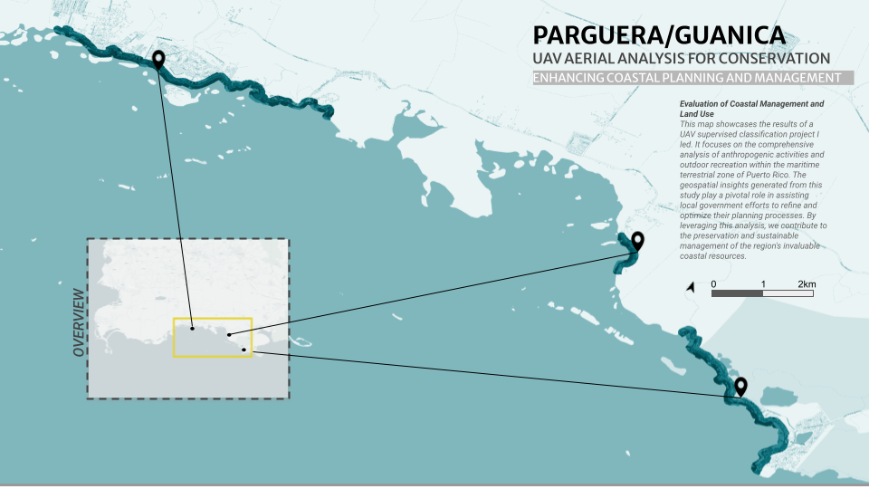
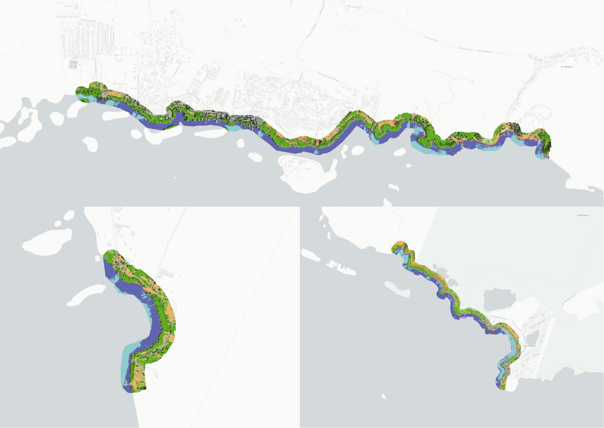
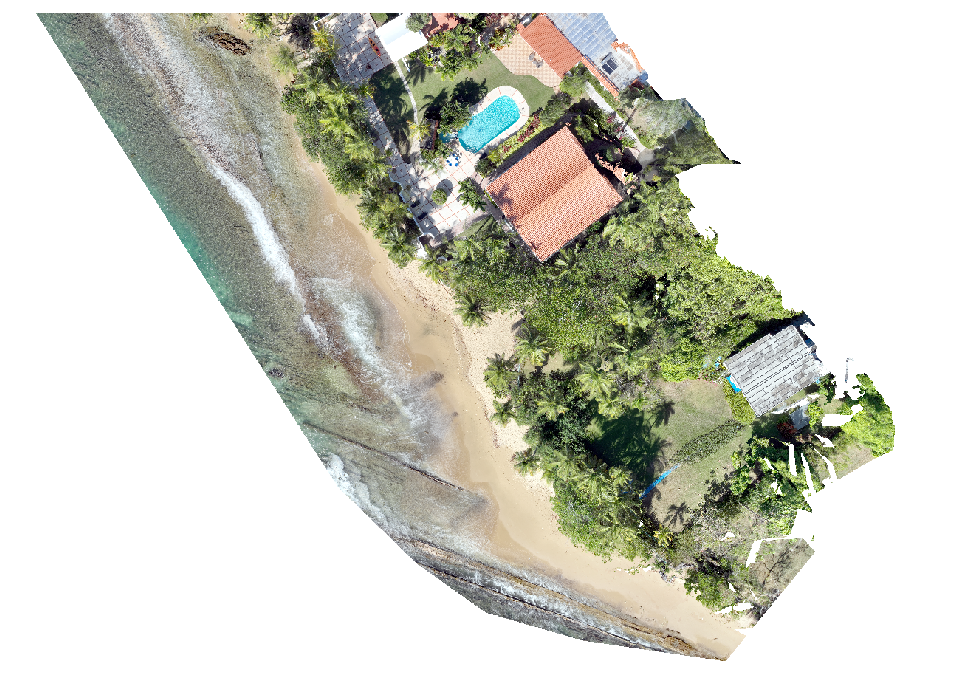
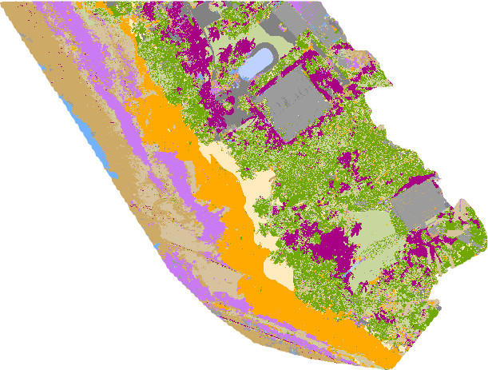

---
hide:
  - navigation
---

Green-light theme map, La Parguera – Guánica
{ .carousel__caption }

Multi-AOI map sheet · [Open full PDF](../assets/img/Parguera_new_multi_aoi.pdf)
{ .carousel__caption }

Reclassified imagery tile, Rincón
{ .carousel__caption }

Classification review of an imagery tile, Rincón
{ .carousel__caption }

<button type="button" class="carousel__btn carousel__btn--prev" aria-label="Previous image">‹</button>
<button type="button" class="carousel__btn carousel__btn--next" aria-label="Next image">›</button>

# Reality Capture Workflow

Deep learning land cover classification of drone and satellite imagery to map human activity and recreation pressure on Puerto Rico's coast.

<ul class="chips">
<li>Drone Imagery</li>
<li>Satellite Imagery</li>
<li>Deep Learning</li>
<li>Land Cover</li>
<li>ArcGIS Pro</li>
<li>Open Source</li>
</ul>

<nav class="section-nav">
<a href="#problem">Problem</a>
<a href="#objective">Objective</a>
<a href="#data">Data</a>
<a href="#pipeline">Pipeline</a>
<a href="#result">Result</a>
<a href="#links">Links</a>
</nav>

## Problem

Local government needed spatial evidence of anthropogenic activity and recreation pressure in Puerto Rico's coastal zone to support planning and resource preservation decisions.

## Objective

Classify high-resolution satellite and drone imagery for each study area, choose the right land cover classes through data analysis, validate them with field data, and calculate the area of each class. The deliverables were a GIS layer for each area of interest, delivered as Shapefile or GeoJSON.

## Data

- High-resolution satellite imagery
- Drone (UAV) imagery
- Field data for class validation
- Coverage: coastal study areas in Puerto Rico, including ncón and La Parguera – Guánica

<h2 id="pipeline">Pipeline</h2>

A hybrid workflow combining open-source tools and ArcGIS Pro, built around deep learning classification.

  

    
Follow the process. Expand a step for the details.

    <button type="button" class="wf-play" aria-pressed="true">Pause animation</button>
  

  <ol class="wf-steps">
    <li class="wf-step">
      <article class="wf-card">
        

          <svg viewBox="0 0 24 24" width="18" height="18" fill="none" stroke="currentColor" stroke-width="1.75" stroke-linecap="round" stroke-linejoin="round"><rect x="3" y="4" width="18" height="16" rx="2"/><circle cx="8.5" cy="10" r="1.5"/><path d="M21 16l-5-5-4 4-3-3-6 6"/></svg>
          01
        

        <h3 class="wf-card__title">Imagery Input</h3>
        

          

            
Collected high-resolution satellite and drone imagery for each study area as the raster input for the workflow.

          

        

        <button type="button" class="wf-toggle" aria-expanded="false" aria-controls="wf-p1">Details +</button>
      </article>
    </li>
    <li class="wf-step">
      <article class="wf-card">
        

          <svg viewBox="0 0 24 24" width="18" height="18" fill="none" stroke="currentColor" stroke-width="1.75" stroke-linecap="round" stroke-linejoin="round"><path d="M12 2l9 5-9 5-9-5 9-5z"/><path d="M3 12l9 5 9-5"/></svg>
          02
        

        <h3 class="wf-card__title">Segmentation &amp; Class Design</h3>
        

          

            
Split the imagery into segments and analyzed the data to decide which land cover classes to map.

          

        

        <button type="button" class="wf-toggle" aria-expanded="false" aria-controls="wf-p2">Details +</button>
      </article>
    </li>
    <li class="wf-step">
      <article class="wf-card">
        

          <svg viewBox="0 0 24 24" width="18" height="18" fill="none" stroke="currentColor" stroke-width="1.75" stroke-linecap="round" stroke-linejoin="round"><circle cx="5" cy="6" r="2"/><circle cx="5" cy="18" r="2"/><circle cx="12" cy="12" r="2"/><circle cx="19" cy="6" r="2"/><circle cx="19" cy="18" r="2"/><path d="M7 7l3 3.5M7 17l3-3.5M14 10.5L17 7M14 13.5L17 17"/></svg>
          03
        

        <h3 class="wf-card__title">Deep Learning Classification</h3>
        

          

            
Classified the segments with a deep learning methodology, combining open-source tools with ArcGIS Pro.

          

        

        <button type="button" class="wf-toggle" aria-expanded="false" aria-controls="wf-p3">Details +</button>
      </article>
    </li>
    <li class="wf-step">
      <article class="wf-card">
        

          <svg viewBox="0 0 24 24" width="18" height="18" fill="none" stroke="currentColor" stroke-width="1.75" stroke-linecap="round" stroke-linejoin="round"><path d="M12 3l8 3v6c0 5-3.5 8-8 9-4.5-1-8-4-8-9V6z"/><path d="M8.5 12l2.5 2.5 4.5-5"/></svg>
          04
        

        <h3 class="wf-card__title">Reclassification &amp; QC</h3>
        

          

            
Refined the first results through reclassification, validated the classes with field data, and checked integrity, completeness and agreed standards.

          

        

        <button type="button" class="wf-toggle" aria-expanded="false" aria-controls="wf-p4">Details +</button>
      </article>
    </li>
    <li class="wf-step">
      <article class="wf-card">
        

          <svg viewBox="0 0 24 24" width="18" height="18" fill="none" stroke="currentColor" stroke-width="1.75" stroke-linecap="round" stroke-linejoin="round"><path d="M14 3H6a2 2 0 0 0-2 2v14a2 2 0 0 0 2 2h12a2 2 0 0 0 2-2V9z"/><path d="M14 3v6h6"/><path d="M12 11v6"/><path d="M9 14l3 3 3-3"/></svg>
          05
        

        <h3 class="wf-card__title">Area Calculation &amp; Export</h3>
        

          

            
Calculated the area of each class, exported one GIS layer per area of interest as Shapefile or GeoJSON, and stored the results on the NAS server.

          

        

        <button type="button" class="wf-toggle" aria-expanded="false" aria-controls="wf-p5">Details +</button>
      </article>
    </li>
  </ol>

## Result

- Completed the full segment workflow, from raster input to final vector output.
- Classified and refined the segments, then validated them through quality control.
- Delivered GIS layers for each area of interest as Shapefile or GeoJSON, ready for desktop and web GIS.
- Stored the dataset in an organized folder structure on the NAS server for easy access.
- Gave local government processed coastal land cover data to support planning and preservation decisions.

## Links

- [Story Map](https://storymaps.arcgis.com/stories/d25ee620cdfe4e52853f89161dc8d1b5)

