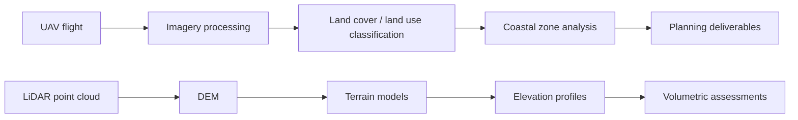

---
hide:
  - navigation
---

## At a Glance

UAV imagery processing and LiDAR analysis for coastal land cover classification and 3D terrain modeling. Role: geospatial analyst. `UAV` `Drone` `LiDAR` `PDAL` `DEM` `ArcGIS`

## Problem

Local government needed spatial evidence of anthropogenic activity and recreation pressure in Puerto Rico's coastal zone to support planning and resource preservation decisions.

## Data

- UAV imagery and aerial photography
- LiDAR point clouds
- Digital Elevation Models (DEMs)
- Coverage: Puerto Rico maritime terrestrial zone
- CRS: [PLACEHOLDER]
- Record count: [PLACEHOLDER]

## Pipeline

**UAV / land cover track:**

1. UAV flight
2. Imagery processing
3. Land cover/land use classification
4. Coastal zone analysis
5. Planning deliverables

**LiDAR / terrain track:**

1. LiDAR point cloud
2. DEM
3. Terrain models
4. Elevation profiles
5. Volumetric assessments

## Result

- [PLACEHOLDER] Geospatial analysis supporting local government planning processes and coastal resource preservation
- [PLACEHOLDER] Detailed topographic models and volumetric assessments for urban planning and environmental monitoring

## What I'd Do Next

Publish processed point clouds as COPC on S3 and stream directly into a CesiumJS viewer for browser-based coastal change monitoring without GIS software.

## Links

- [Story Map](https://storymaps.arcgis.com/stories/d25ee620cdfe4e52853f89161dc8d1b5)
- [Repo]()
- [README]()
