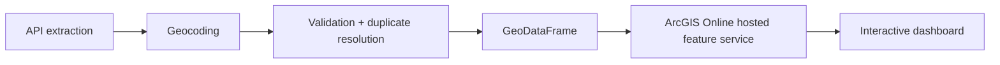

---
hide:
  - navigation
---

## At a Glance

Containerized spatial ETL pipeline automating field inspection data from API to ArcGIS Online hosted feature services; designed and developed. `Python` `GeoPandas` `ArcGIS Online` `Docker`

## Problem

Stakeholders needed real-time visibility into field inspections. Manual data handling caused delays, duplicates, and no spatial context for resource allocation decisions.

## Data

- Internal API source
- Geocoded point features
- CRS: [CRS — PLACEHOLDER]
- Record count: [record count — PLACEHOLDER]

## Pipeline

1. API extraction
2. Geocoding
3. Validation and duplicate resolution
4. Transformed into GeoDataFrames
5. Published as ArcGIS Online hosted feature services (cloud storage, scheduled updates)
6. Powers an interactive dashboard for real-time geospatial visualization

## Result

- [PLACEHOLDER] Automated end-to-end pipeline with scheduled updates
- [PLACEHOLDER] Interactive dashboard for real-time geospatial visualization, enabling stakeholders to monitor field inspections and optimize resource allocation
- [record count — PLACEHOLDER]

## What I'd Do Next

Replace ArcGIS Online dependency with a PostGIS backend and open-source dashboard for full infrastructure control.

## Links

- [Live viewer]()
- [Repo]()
- [README]()
