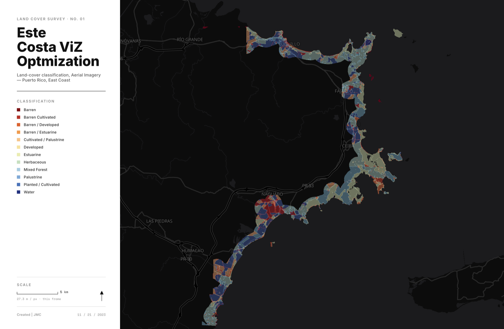

---
hide:
  - navigation
---

# Wetlands Dataset Optimization & Web Publishing

Optimizing large-scale geospatial datasets for high-performance web deployment across ArcGIS Online and GeoServer.

<ul class="chips">
<li>Python</li>
<li>PostgreSQL/PostGIS</li>
<li>GeoPackage</li>
<li>GDAL</li>
<li>GeoServer</li>
<li>ArcGIS Online</li>
</ul>

<nav class="section-nav">
<a href="#problem">Problem</a>
<a href="#workflow">Workflow</a>
<a href="#results-impact">Results &amp; Impact</a>
</nav>

## Problem

Large geographic databases (GDB) often become unwieldy and slow when deployed directly to web platforms. The challenge was to optimize a massive wetlands dataset to ensure fast rendering, data integrity, and seamless interoperability across ArcGIS Online and GeoServer without losing critical classification data.

<h2 id="workflow">Workflow</h2>

  

    
Follow the process. Expand a step for the details.

    <button type="button" class="wf-play" aria-pressed="true">Pause animation</button>
  

  <ol class="wf-steps">
    <li class="wf-step">
      <article class="wf-card">
        

          <svg viewBox="0 0 24 24" width="18" height="18" fill="none" stroke="currentColor" stroke-width="1.75" stroke-linecap="round" stroke-linejoin="round"><path d="M17 1l4 4-4 4"/><path d="M3 11V9a4 4 0 0 1 4-4h14"/><path d="M7 23l-4-4 4-4"/><path d="M21 13v2a4 4 0 0 1-4 4H3"/></svg>
          01
        

        <h3 class="wf-card__title">Format Conversion</h3>
        

          

            
Migrated the heavy GDB into GeoPackage (GPKG) to drastically improve processing speeds and manipulation.

          

        

        <button type="button" class="wf-toggle" aria-expanded="false" aria-controls="wf-p1">Details +</button>
      </article>
    </li>
    <li class="wf-step">
      <article class="wf-card">
        

          <svg viewBox="0 0 24 24" width="18" height="18" fill="none" stroke="currentColor" stroke-width="1.75" stroke-linecap="round" stroke-linejoin="round"><rect x="3" y="3" width="18" height="18" rx="2"/><path d="M3 12h18"/><path d="M12 3v18"/></svg>
          02
        

        <h3 class="wf-card__title">Spatial Tiling</h3>
        

          

            
Generated a spatial grid to segment the dataset into manageable quads for efficient processing.

          

        

        <button type="button" class="wf-toggle" aria-expanded="false" aria-controls="wf-p2">Details +</button>
      </article>
    </li>
    <li class="wf-step">
      <article class="wf-card">
        

          <svg viewBox="0 0 24 24" width="18" height="18" fill="none" stroke="currentColor" stroke-width="1.75" stroke-linecap="round" stroke-linejoin="round"><polygon points="22 3 2 3 10 12.5 10 19 14 21 14 12.5 22 3"/></svg>
          03
        

        <h3 class="wf-card__title">Masking &amp; Filtering</h3>
        

          

            
Applied spatial masks to isolate wetland features and filtered out noise by setting a minimum area threshold.

          

        

        <button type="button" class="wf-toggle" aria-expanded="false" aria-controls="wf-p3">Details +</button>
      </article>
    </li>
    <li class="wf-step">
      <article class="wf-card">
        

          <svg viewBox="0 0 24 24" width="18" height="18" fill="none" stroke="currentColor" stroke-width="1.75" stroke-linecap="round" stroke-linejoin="round"><path d="M14 3H6a2 2 0 0 0-2 2v14a2 2 0 0 0 2 2h12a2 2 0 0 0 2-2V9z"/><path d="M14 3v6h6"/><path d="M9 15l2 2 4-4"/></svg>
          04
        

        <h3 class="wf-card__title">Attribute Validation</h3>
        

          

            
Used Python and PostGIS SQL queries to inspect and validate the <code>GeneralClass</code> field, confirming the presence of Estuarine and Palustrine wetland types. Verified data consistency across GPKG, GeoJSON, and Shapefile formats.

          

        

        <button type="button" class="wf-toggle" aria-expanded="false" aria-controls="wf-p4">Details +</button>
      </article>
    </li>
    <li class="wf-step">
      <article class="wf-card">
        

          <svg viewBox="0 0 24 24" width="18" height="18" fill="none" stroke="currentColor" stroke-width="1.75" stroke-linecap="round" stroke-linejoin="round"><path d="M13 2L3 14h9l-1 8 10-12h-9l1-8z"/></svg>
          05
        

        <h3 class="wf-card__title">Web Optimization</h3>
        

          

            
Applied Visvalingam simplification and PostGIS procedures to reduce file size while maintaining geometric fidelity for web publishing.

          

        

        <button type="button" class="wf-toggle" aria-expanded="false" aria-controls="wf-p5">Details +</button>
      </article>
    </li>
  </ol>

## Results & Impact { #results-impact }

Delivered a highly optimized, interoperable dataset successfully deployed to AGOL and GeoServer. The pipeline maintained 100% data integrity across multiple export formats, enabling fast, responsive web mapping for environmental analysis.

